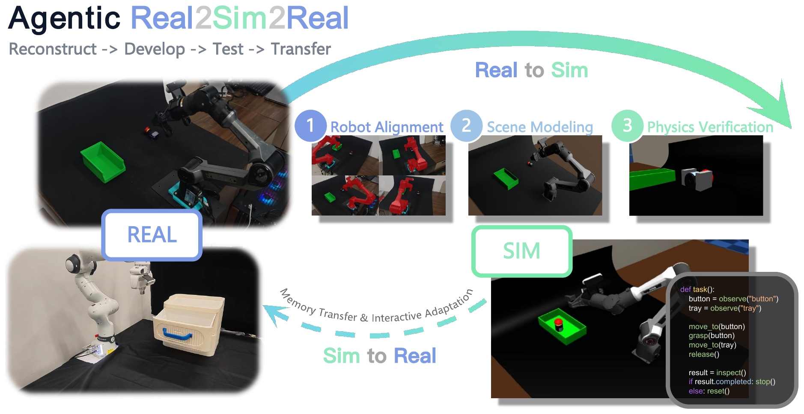
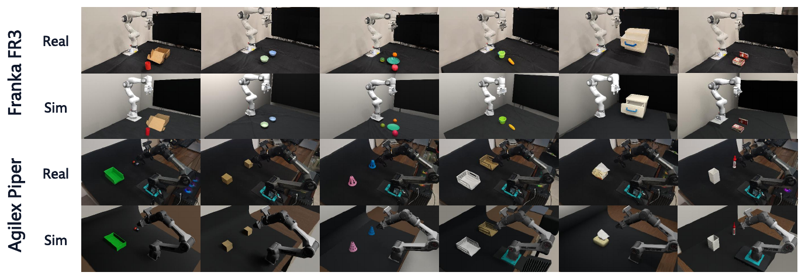
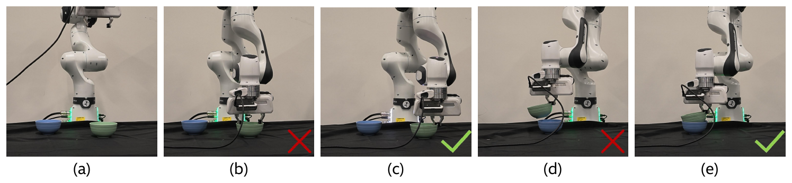

<div align="center">

# Agentic RSR

### Real-to-Sim-to-Real through Scene Reconstruction and Execution-Grounded Robot Policies

[English](README.md) · **简体中文**

Yihan Li¹† · Yating Feng² · Shengjiu Sun¹ · Jianing Chen¹ · Hao Ren¹<br>
Bowen Yang² · Weisheng Xu² · Qiwei Wu² · Hui Cheng¹ · Renjing Xu²†

<a href="https://www.sysu.edu.cn/"></a>&nbsp;&nbsp;&nbsp;&nbsp;
<a href="https://www.hkust-gz.edu.cn/"></a>

¹ Sun Yat-sen University · ² HKUST (Guangzhou) · † Corresponding authors

[](https://hy-liyihan.github.io/agentic_rsr/)
[](https://arxiv.org/abs/2610.10479)
[](https://huggingface.co/datasets/HY-LiYihan/Agentic-RSR-experiment-results-20261007)
[](docs/WORKFLOW.md)
[](docs/LOCAL_INFERENCE.md)



</div>

从工作空间视频、任务描述和已知机器人模型出发，恢复米制场景，在 Blender 中迭代建模，在 MuJoCo 中验证交互，并通过执行反馈开发机器人策略。三个 Real2Sim 阶段之后，策略依次经过特权状态、视觉观测和随机化仿真；论文进一步展示了经验迁移与真机适应。

## 结果可视化





## 当前可用范围

| 环节 | 公共实现与验证边界 |
| --- | --- |
| Stage 1：机器人配准 | 本地默认 VGGT-Ω / SAM3、32 帧 512×288、URDF 米制锚定、四参考相机 `.blend`。CPU 缓存回放和完整配准 / 交付已验证；真实本地 CUDA 权重推理待验收。 |
| Stage 2：视觉建模 | Codex 分阶段规划 / 建模 / 反馈优化，冻结机器人与相机，以深度、颜色和覆盖率联合检查。论文最新 DSH 重建配置不包含在该 checkout 的复现保证中。 |
| Stage 3：物理调优 | Blender→MuJoCo 导出、语义和物理检查、参数修订接口；任务级结果需检查各自产物及 manifest。 |
| SIM / 真机 | 特权、视觉和随机化策略入口；真机适配及独立安全验收仍需补齐。论文中的硬件结果不代表公共代码已可直接安全运行真机。 |

Stage 1 生产配准使用全部 32 帧评分，交付保持 `candidate_unverified`、`accepted=false`；四参考视角来自同一视频。完整实验输入和本地 CUDA 推理验收尚未完成，当前不是完整论文复现发行版。

## 安装与最小示例

目标环境：**Linux x86_64、NVIDIA CUDA、Python 3.11**。需要 [uv](https://docs.astral.sh/uv/getting-started/installation/)；Blender 用于场景生成和评估。模型源码通过 HTTPS 子模块固定；权重、视频和凭据单独准备。

```bash
git clone --recurse-submodules https://github.com/HY-LiYihan/agentic_rsr.git
cd agentic_rsr
uv sync --locked --python 3.11 --extra local --extra sim --extra agent --extra dev
cp -n .env.example .env
```

按[安装文档](docs/LOCAL_INFERENCE.md)申请官方权重并放入 `model/vggt_omega/vggt_omega_1b_512.pt`、`model/sam3/sam3.pt`。保持 `VGGT_OMEGA_BACKEND=local` 和 `SAM3_BACKEND=local`；缺少权重或设备会明确失败，不自动下载或切换远端。

```bash
uv run --no-sync real2sim-models check
uv run --no-sync real2sim-local-example \
  --video /path/to/task.mp4 --robot piper --output runs/my-first-example
```

视频需至少 32 帧，输出目录需不存在。最小示例生成 RGB、深度、相机、mask、可视化和模型来源 manifest；不等同于完成配准或场景验收。从视频到 Stage 1→2→3→SIM 的命令与阶段交付检查见[完整工作流](docs/WORKFLOW.md)。

历史实验产物已归档到 [Hugging Face](https://huggingface.co/datasets/HY-LiYihan/Agentic-RSR-experiment-results-20261007)，目前为私有数据集，需授权账号访问。目录和固定版本下载命令见数据集 card 及[资产分发说明](docs/ASSET_DISTRIBUTION.md)；当前 Git 中资产的迁移仍待完成。模型权重继续从官方上游获取。

无需权重的测试：

```bash
uv sync --locked --python 3.11 --extra sim --extra dev
uv run --no-sync python -m pytest tests/unit tests/integration -m 'not models' -ra
```

GitHub 测试 CI 已按作者要求移除。离线测试和模型验收分别运行；测试跳过不代表通过。macOS CPU 验证记录见 [Stage 1 验证](docs/STAGE1_CPU_VALIDATION.md)。

## 文档与贡献

- [完整工作流](docs/WORKFLOW.md) · [数据与阶段契约](docs/DATA_CONTRACT.md) · [文档索引](docs/README.md)
- [本地模型安装](docs/LOCAL_INFERENCE.md) · [Stage 1 交付](src/real2sim/stage1/README.md) · [Stage 2](src/real2sim/stage2/README.md) · [Stage 3](src/real2sim/stage3/README.md) · [SIM](src/sim/README.md)
- [贡献说明](CONTRIBUTING.md) · [测试说明](tests/README.md) · [发布准备与未完成项](docs/OPEN_SOURCE_PREPARATION.md)
- [资产分发说明](docs/ASSET_DISTRIBUTION.md) · [第三方许可](docs/THIRD_PARTY.md) · [论文图与学校标识来源](docs/ASSET_SOURCES.md)

## 许可证

主项目代码采用 [Apache-2.0](LICENSE)。第三方源码、权重、机器人资产、派生文件、论文媒体和学校标识分别适用其原有条款。VGGT-Ω 限非商业研究，Ultralytics / CLIP 使用 AGPL，SAM3 权重适用 Meta SAM License。通过 Hugging Face 发布不改变资产原有许可。

## 引用

请引用 [arXiv 论文](https://arxiv.org/abs/2610.10479)，机器可读的引用信息见 [CITATION.cff](CITATION.cff)。

```bibtex
@misc{li2026agenticrsr,
  title={Agentic RSR: Real-to-Sim-to-Real through Scene Reconstruction and Execution-Grounded Robot Policies},
  author={Li, Yihan and Feng, Yating and Sun, Shengjiu and Chen, Jianing and Ren, Hao and Yang, Bowen and Xu, Weisheng and Wu, Qiwei and Cheng, Hui and Xu, Renjing},
  year={2026},
  eprint={2610.10479},
  archivePrefix={arXiv},
  primaryClass={cs.RO},
  url={https://arxiv.org/abs/2610.10479}
}
```
